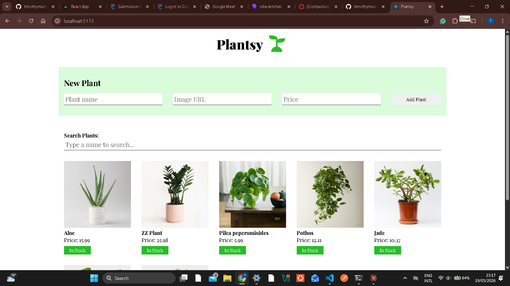

# 🌿 Plant Shop

A React application for browsing and managing a plant inventory.

## Features

- 🌱 View all plants on page load (fetched from a local JSON server)
- ➕ Add a new plant via the form (persisted to backend)
- 🔴 Mark any plant as "Out of Stock" (local toggle)
- 🔍 Search/filter plants by name in real time

## Setup

1. Clone the repo
2. Install dependencies:
```bash
   npm install
```
3. Run the backend (port 6001):
```bash
   npm run server
```
4. Run the frontend (port 5173):
```bash
   npm run dev
```
5. Run tests:
```bash
   npm run test
```

## Screenshot



## Tech Stack

- React 18 + Vite
- json-server (mock REST API)
- Vitest + React Testing Library