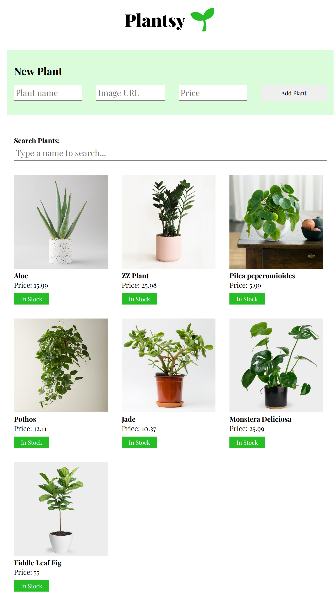

# Plantsy 🌱

Plantsy is a React admin app for a plant store. It connects to a JSON Server backend so you can view, add, and search plants.



## Features

- **View all plants**: plants are fetched from the backend with `useEffect` when the page loads.
- **Add a plant**: submit the form to send a `POST` request to the backend and show the new plant instantly.
- **Mark as sold out**: each plant card has an "In Stock" button that switches to "Out of Stock" (not saved to the backend).
- **Search**: filter plants by name as you type. Clearing the search shows all plants again.

## Tech Stack

- React (hooks: `useState`, `useEffect`)
- Vite
- JSON Server
- Vitest and React Testing Library

## Getting Started

1. Clone the repository:
   ```
   git clone <your-repo-url>
   cd react-hooks-plantshop-cr-vite
   ```
2. Install dependencies:
   ```
   npm install
   ```
3. Start the backend (runs on port 6001):
   ```
   npm run server
   ```
4. In a second terminal, start the app:
   ```
   npm run dev
   ```
5. Open the URL shown in the terminal (usually http://localhost:5173).

To check the backend, visit http://localhost:6001/plants.

## Running Tests

```
npm run test
```

## API Endpoints

| Method | Endpoint  | Description        |
| ------ | --------- | ------------------ |
| GET    | `/plants` | Get all plants     |
| POST   | `/plants` | Create a new plant |

Example plant:

```json
{
  "id": 1,
  "name": "Aloe",
  "image": "./images/aloe.jpg",
  "price": 15.99
}
```

## Project Structure

```
src/components/
├── App.jsx
├── Header.jsx
├── PlantPage.jsx      # fetches plants, holds plants and search state
├── NewPlantForm.jsx   # form that POSTs a new plant
├── Search.jsx         # search input
├── PlantList.jsx      # renders the list of plants
└── PlantCard.jsx      # single plant with in-stock toggle
```

## Author

Sean Simiyu